Siddharth Kumar is the founder of SteadyData, an e-commerce data service that monitors competitor prices, stock and catalog changes for online stores and sends verified change reports daily or weekly.

**[steadydata.co](https://steadydata.co)** · [siddharthkumar.com](https://siddharthkumar.com) · [LinkedIn](https://www.linkedin.com/in/siddharthkumarx/) · [siddharth@steadydata.co](mailto:siddharth@steadydata.co)

Price monitoring · competitor price tracking · stock monitoring · e-commerce data · web scraping · data extraction

## What SteadyData does

- Tracks competitor prices, sales, stock and catalog changes on the online stores you name.
- Sends a verified change report daily or weekly: Excel/CSV + PDF, or Google Sheets. Fixes are included when a site changes.
- Public data only.

## Live proof

| Project | What it does | Proof |
|:---|:---|:---|
| **[ecommerce-price-monitor](https://github.com/siddharthkumarx/ecommerce-price-monitor)** | Daily prices, sales and stock from 25 US online stores |    · [Dashboard](https://siddharthkumar.com/ecommerce-price-monitor/) · [Repo](https://github.com/siddharthkumarx/ecommerce-price-monitor) |
| **[job-postings-pipeline](https://github.com/siddharthkumarx/job-postings-pipeline)** | Daily open jobs at 1,500 US tech companies | As of 20 Nov 2026: 64,204 open jobs · 1,493 of 1,500 job boards read · second-source spot check of 30 random jobs: 30 of 30 matched · [Dashboard](https://siddharthkumar.com/job-postings-pipeline/) · [Repo](https://github.com/siddharthkumarx/job-postings-pipeline) |

As of 22 Nov 2026, ecommerce-price-monitor read 11,703 rows in its latest run, delivered 19 of 19 due daily runs, started 1 of 1 runs on time since 22 Nov, and matched 25 of 25 sample prices (one per store) against a second source.

## Projects

| Project | In plain words |
|:---|:---|
| [ecommerce-price-monitor](https://github.com/siddharthkumarx/ecommerce-price-monitor) | Daily prices, sales and stock from 25 US online stores, as a spreadsheet and a live dashboard. |
| [job-postings-pipeline](https://github.com/siddharthkumarx/job-postings-pipeline) | Every open job at 1,500 US tech companies, collected daily into one clean table. |
| [cross-store-price-comparison](https://github.com/siddharthkumarx/cross-store-price-comparison) | Prices for the same products compared across stores. In progress, built in public. |
| [scrapeplanner](https://github.com/siddharthkumarx/scrapeplanner) | Open-source command-line tool: point it at a URL and it reports the cheapest polite way to collect that site's data. |
| [scrapewatch](https://github.com/siddharthkumarx/scrapewatch) | A health and cost monitor for any web scraper. Work in progress. |

## How the data stays reliable

- Every row is validated, and each run re-reads a sample from a second source.
- Doubtful values are held back, never guessed.
- Nothing goes silently missing: a page that could not be read is marked as not updated.
- Polite collection: public pages only, robots.txt respected.
- Fixes are included when a site changes.

## Tools

Python (async httpx) · Playwright · PostgreSQL · DuckDB · Docker Compose · Linux VPS · GitHub Actions CI · Cloudflare R2 · Google Sheets API · webhooks · Published Python package: [scrapeplanner (PyPI)](https://pypi.org/project/scrapeplanner/)

## Contact

[siddharth@steadydata.co](mailto:siddharth@steadydata.co) · [steadydata.co](https://steadydata.co) · [LinkedIn](https://www.linkedin.com/in/siddharthkumarx/) · IST (UTC+5:30)

No sales calls needed. Everything by email.
